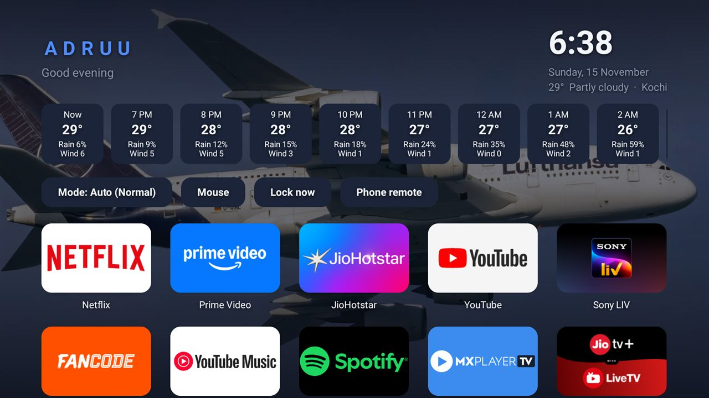
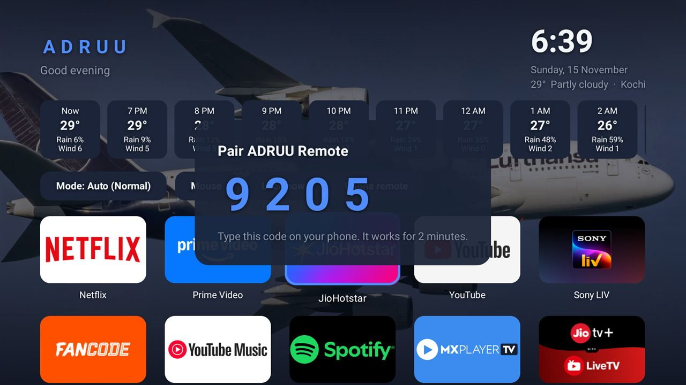

# ADRUU TV

A lightweight custom home screen for Android TV / Google TV, with a companion phone remote app.

ADRUU was built for a 2 GB TCL Google TV (Android 11) that lagged with the stock launcher. It is written
in plain Java against the Android SDK, uses no third-party libraries and the APK is about 5 MB.

| | |
|---|---|
|  |  |
| Home: clock, 12-hour weather, quick buttons, apps | Scroll animation: header slides away, wallpaper parallax |
|  |  |
| Your own photo as wallpaper, theme colours picked from it | Phone pairing with a 4-digit code on the TV |

## Features

### TV app (`adruu-launcher`)
- Tablet-style home screen with favourite streaming apps first and smooth focus animations
- Scroll animation with parallax photo wallpapers (planes, cars, bikes, or your own photo albums with slideshow)
- Themes, including a theme generated from your photo and festival themes that switch by date
  (Onam, Vishu, Diwali, Christmas, Eid, Holi, Independence Day and more)
- Clock, date, current weather and a next-12-hours forecast strip from [Open-Meteo](https://open-meteo.com)
- Animated startup intro with synthesised sound, or a custom startup video
- Optional 6-digit PIN lock, instant lock from the phone, guest mode, screen time per app
- Viewing modes (Auto / Movie / Music / Game) that control do-not-disturb
- On-screen mouse pointer for apps that need one (key interception only while it is on)
- Built-in health monitor: records crashes, freezes and disabled settings, and repairs its own accessibility service
- Token-protected local HTTP API used by the phone app and by scripts ([API reference](docs/API.md))

### Phone app (`adruu-remote`, under 100 KB)
- Finds the TV on your Wi-Fi and pairs with the code shown on screen
- Remote buttons, soundbar volume over HDMI-CEC, touchpad, air mouse and scroll
- Send links to the TV, open or uninstall apps, search the Play Store, install APKs
- Upload wallpaper photos and a startup video, lock / unlock, view screen time
- "Report a problem" with voice typing in Malayalam or English
- Push alerts through [ntfy](https://ntfy.sh) (TV turned on, wrong PIN, locked TV in use)
- Remote control away from home through Tailscale
- Updates itself from the TV

## Tech stack
- Java 8 language level, Android SDK (TV app targets API 30, phone app targets API 35)
- Built without Gradle: `aapt2 → javac → d8 → zipalign → apksigner`, driven by PowerShell scripts
- Embedded HTTP server and a single-file HTML/CSS/JS control page served from the TV
- Open-Meteo weather API, ntfy push notifications

## Install
Download the APKs from [Releases](../../releases).

- **TV:** enable USB debugging, then `adb install ADRUU-TV-2.0.apk`. Making it the default home screen
  on Google TV and the permissions it needs are described in [docs/API.md](docs/API.md).
  [`undo-tv-changes.ps1`](adruu-launcher/tests/undo-tv-changes.ps1) reverts every change.
- **Phone:** install `ADRUU-Remote-2.0.apk` (allow "install unknown apps") and open it on the same Wi-Fi as the TV.

## Build
Requires JDK 17 and Android SDK build-tools 34 + platform 30 (Windows, PowerShell). The scripts look for the
JDK in `%LOCALAPPDATA%\ADRUU-tools\jdk` and the SDK in `%LOCALAPPDATA%\Android`.

```powershell
powershell -File adruu-remote\build.ps1      # build the phone app first: the TV app bundles it
powershell -File adruu-launcher\build.ps1
adb install -r adruu-launcher\ADRUU.apk
```
Signing keys are created on the first build in `%LOCALAPPDATA%\ADRUU-tools\keys` and are never committed.

## Tests
- `adruu-launcher/tests/com/adruu/tv/LogicTest.java` — festival dates, modes and themes
- `adruu-launcher/tests/api-test.ps1` — API tests with no on-screen effects
- `adruu-launcher/tests/tv-test.ps1` — on-screen end-to-end test (restarts the TV)

## Known limits
- On the tested TCL TV, standby turns Wi-Fi off, so the phone can switch the TV **off** but not back **on**.
- Updating the app that is currently the home screen can trigger an Android 11 window-manager restart (~30 s).
- TCL picture presets are private, so ADRUU modes control notifications only.
- The TV app uses ADB-granted permissions and an accessibility service, so it is distributed as a sideload
  rather than through Google Play.

## Credits and license
Code is MIT licensed (see [LICENSE](LICENSE)). Wallpaper photos are from Wikimedia Commons under their own
licenses; see [wall_credits.txt](adruu-launcher/assets/wall_credits.txt). Fonts: Manrope and a Malayalam font
under the SIL Open Font License. Weather data by [Open-Meteo](https://open-meteo.com).

Designed and developed by Adrian A. Antony.
