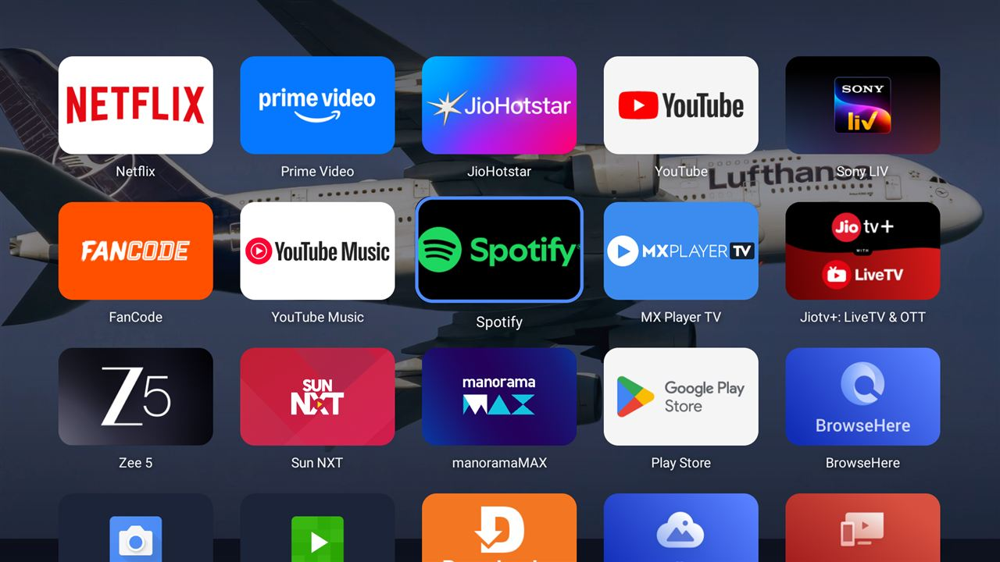
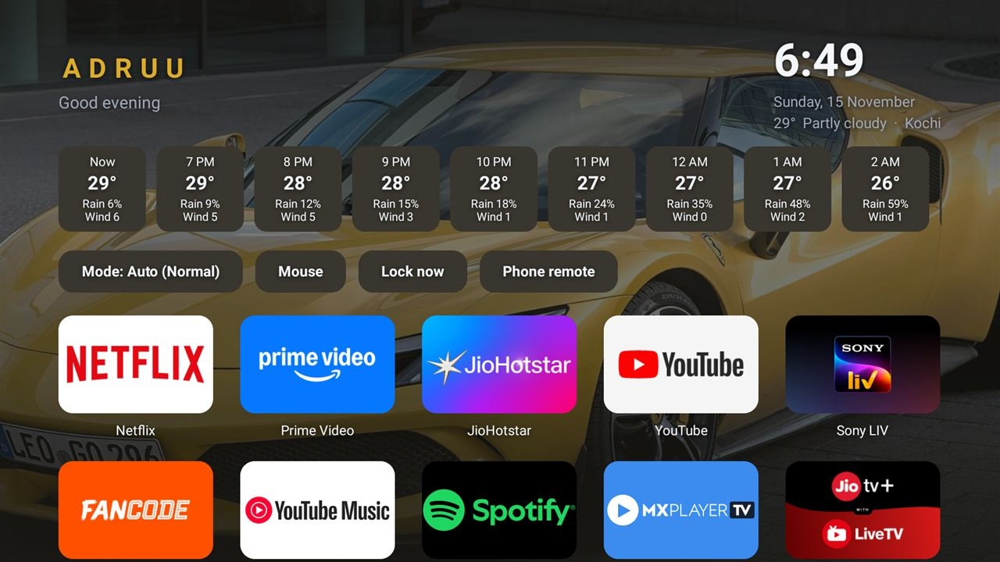

# ADRUU TV

A light, custom home screen for Android TV / Google TV, plus a phone remote app.
Built for a 2 GB TCL Google TV (Android 11) that lagged badly with the stock home screen.

| | |
|---|---|
|  |  |
| Home: clock, 12-hour weather, quick buttons, apps | Website-style scroll: header slides away, wallpaper parallax |
|  |  |
| Your own photo as wallpaper, theme colours picked from it | Phone pairing with a 4-digit code on the TV |

## What's inside

**TV app (`adruu-launcher`, ~4.7 MB, no libraries)**
- Tablet-style home screen, favourite streaming apps first, smooth focus animations
- Website-style scroll animation with parallax photo wallpaper (planes, cars, bikes, or your own photos)
- Themes, festival themes by date (Onam, Vishu, Diwali, Christmas, New Year), theme from your photo
- Clock, date, current weather and a scrollable next-12-hours strip (temperature, rain chance, wind) via Open-Meteo
- Startup animation (a jet lands, a pilot walks out and waves) with generated sound, or your own video
- 6-digit PIN lock (optional), guest mode, screen time, modes (Auto / Movie / Music / Game → do-not-disturb)
- Mouse pointer for apps that need one; key interception only while it's on (no added lag)
- Built-in bug-report bot: records crashes, freezes and settings that got switched off; repairs its own accessibility service
- Local HTTP API (token protected) used by the phone app and by Claude for live changes

**Phone app (`adruu-remote`, ~24 KB)**
- Finds the TV on your Wi-Fi, pairs with the code shown on the TV
- Remote buttons, volume (reaches an HDMI-CEC soundbar), touchpad + air mouse, scroll buttons
- Send links to the TV, open / uninstall apps, find apps on the Play Store, install APKs
- Upload wallpaper photos and a custom startup video; lock / unlock; screen time
- Family "Report a problem" with voice typing (Malayalam or English); reports are saved on the TV
- Updates itself from the TV; an "away" address (Tailscale) lets you control the TV from anywhere

## Install
Download the APKs from [Releases](../../releases).
- **TV:** enable USB debugging on the TV, then `adb install ADRUU.apk`. Making it the home screen on Google TV,
  the permissions it needs and how to undo everything are in [CLAUDE.md](CLAUDE.md)
  and [adruu-launcher/tests/undo-tv-changes.ps1](adruu-launcher/tests/undo-tv-changes.ps1).
- **Phone:** install `ADRUU-Remote.apk` (allow "install unknown apps"), open it on the same Wi-Fi as the TV.

## Build
No Gradle. Needs JDK 17 and Android SDK build-tools 34 + platform 30 (Windows PowerShell scripts):
```
powershell -File adruu-remote\build.ps1
powershell -File adruu-launcher\build.ps1
```
Signing keys are created on first build in `%LOCALAPPDATA%\ADRUU-tools\keys` and are never committed.

## Tests
- `adruu-launcher/tests/api-test.ps1`: API tests, safe while someone watches TV
- `adruu-launcher/tests/tv-test.ps1`: on-screen test, restarts the TV
- `adruu-launcher/tests/com/adruu/tv/LogicTest.java`: festival dates, modes, themes

## Known limits
- On this TCL TV, standby switches Wi-Fi off, so the phone can turn the TV **off** but not back **on**.
- Updating the app that is currently the home screen can trigger an Android 11 window-manager crash that
  restarts the TV once (~30 s). Update when nobody is watching.
- Picture presets (Movie/Game picture modes) are private to TCL, so ADRUU modes only control notifications.

## Credits and license
Code: MIT (see [LICENSE](LICENSE)). Wallpaper photos: Wikimedia Commons, own licenses, see
[wall_credits.txt](adruu-launcher/assets/wall_credits.txt). Weather: [Open-Meteo](https://open-meteo.com).
Built with Claude.
